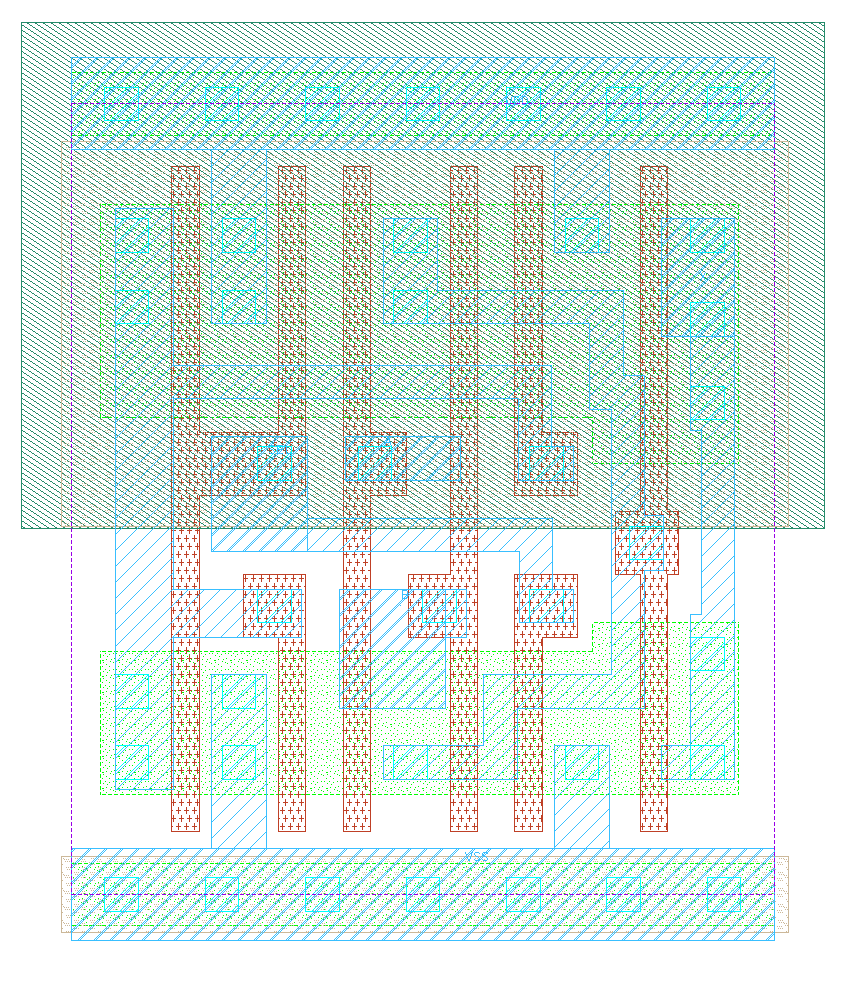
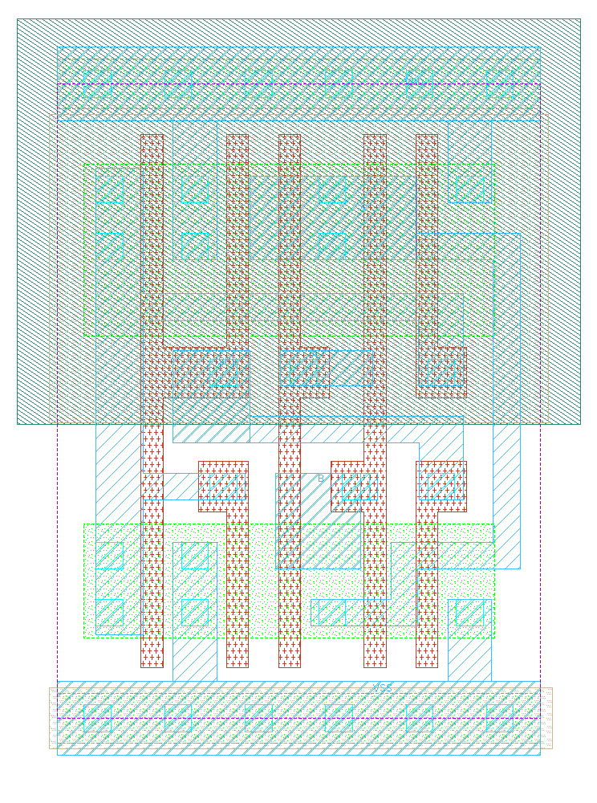
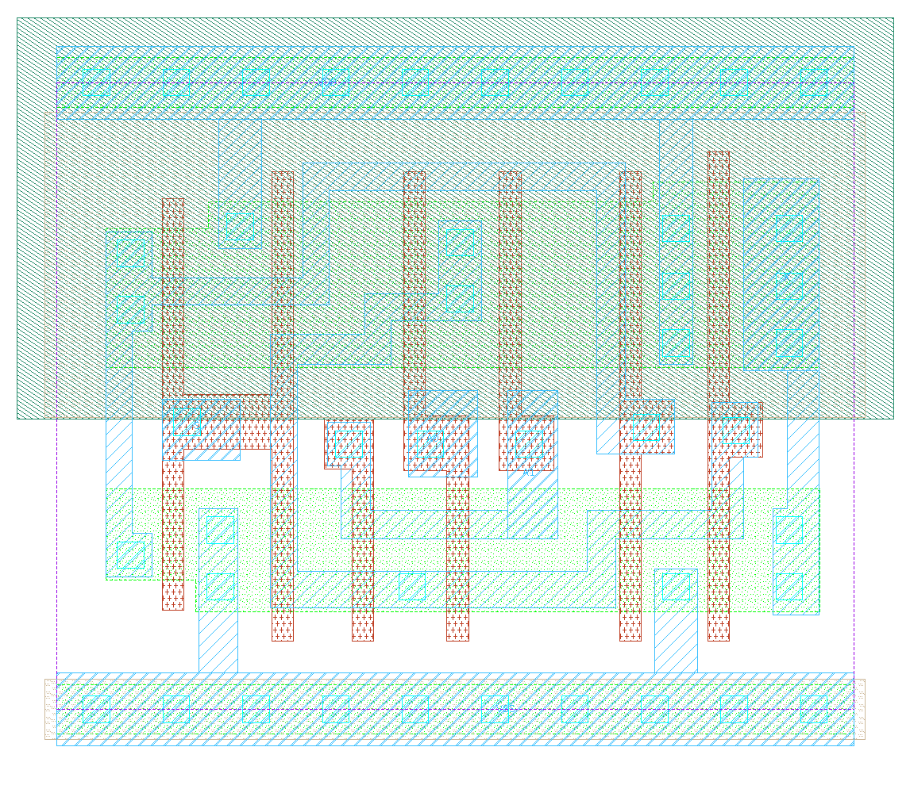
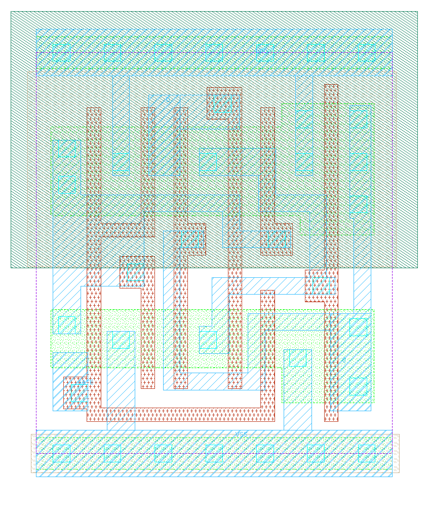
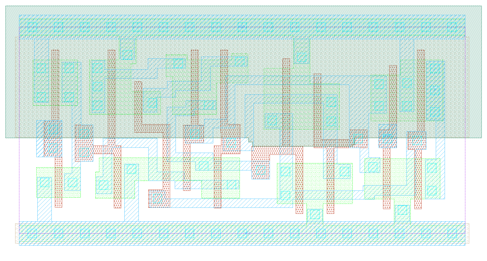
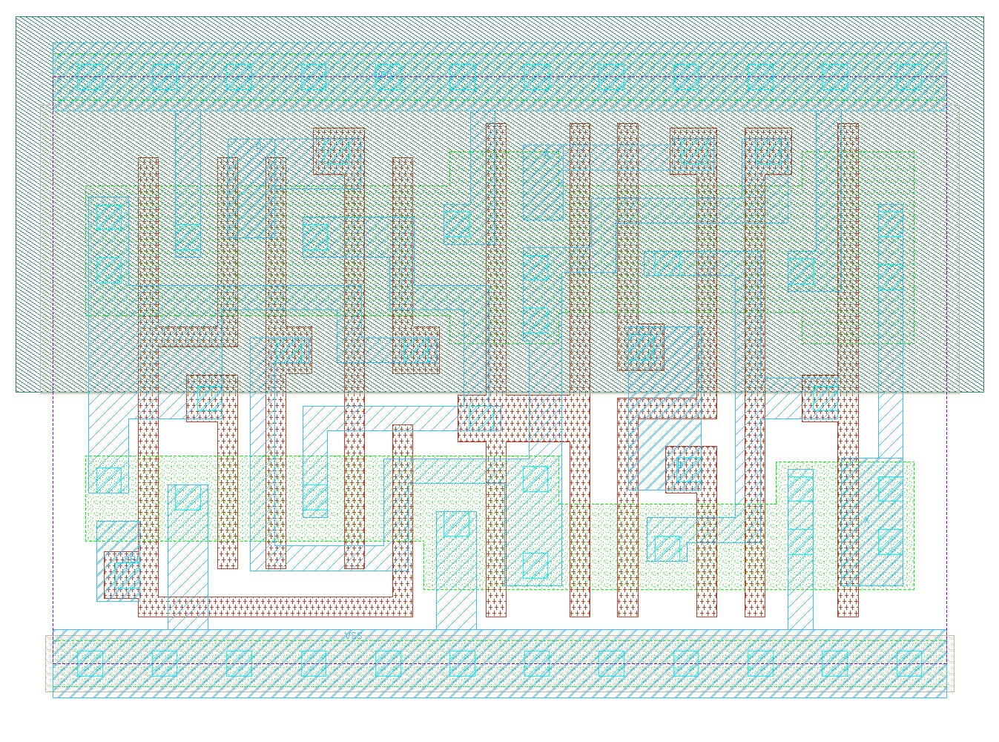
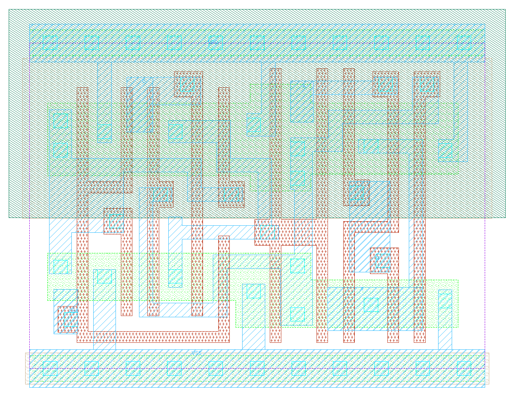
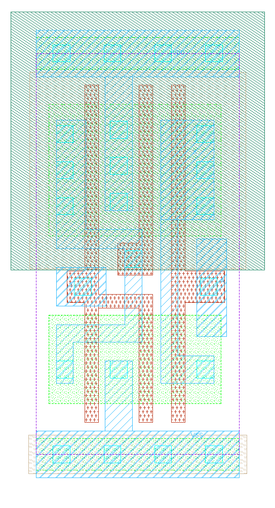

# IHP SG13G2 Small Cells Repository

GDS layouts and corresponding schematics are handcrafted versions of specific standard cells, designed to significantly reduce area requirements.

This local copy has been adapted for the FABulous CMOS5L flow. LEFs have
`SYMMETRY X Y` and explicit pin directions; geometry is unchanged. The
`verilog/` directory contains functional Yosys-compatible models matching the
supplied Liberty files, replacing the transistor schematic exports. Define
`USE_POWER_PINS` to include `VDD` and `VSS` in their interfaces.

GDS, schematics and extracted SPICE remain as supplied upstream. The extracted
SPICE is not enabled in the current abstract LVS flow. Only the latch is enabled
in the shared flow configuration; other cell models are available for future use.
See [the shared recipe](../README.md) for model behavior and configuration.

---

## The Cells

### 1. Multiplexer (`mux` / `mux_inv`)

The multiplexer cell is a 2:1 multiplexer with a single select line implemented using tri-state buffers. 

* **Inverting Version (`mux_inv`):** Even more compact by omitting the output inverter while retaining strong drive strength due to the tri-state stage.
* **Standard Cell Comparison:** Significantly smaller footprint compared to the standard cell library equivalent (`sg13g2_mux2_1`).

| Custom MUX (`mux.png`) | Custom Inverting MUX (`mux_inv.png`) | Standard Cell (`sg13g2_mux2_1.png`) |
| :---: | :---: | :---: |
|  |  |  |

---

### 2. Latch (`latch`)

The latch cell is constructed around the non-inverting multiplexer with feedback routed back to the input.

* **Standard Cell Comparison:** Offers an area-optimized alternative to the default library latch (`sg13g2_dlhq_1`).

| Custom Latch (`latch.png`) | Standard Cell Latch (`sg13g2_dlhq_1.png`) |
| :---: | :---: |
|  |  |

---

### 3. Switch Matrix Multiplexer (`SwitchMatrixMultiplexer`)

The `SwitchMatrixMultiplexer` combines a storage latch directly with a multiplexer so that the latch output drives the select line internally.

* Eliminates external routing overhead by keeping the select connection inside the cell boundaries.
* Saves substantial silicon area compared to placing discrete latch and MUX standard cells side-by-side.

| Non-Inverting | Inverting (`_inv`) |
| :---: | :---: |
|  |  |

---

### 4. Tri-State Buffer (`tri_buff` / `tri_buff_cell`)

Compact tri-state buffer primitive serving as the core building block for the multiplexer topologies.

